 

  

  <b>Full stack developer</b> — builds fast websites, APIs &amp; online stores for clients in the USA, Canada, Australia &amp; Europe ·
  <b>Lives at</b> <a href="https://vaibhawkumar.in">vaibhawkumar.in</a>

 

  

  

  

  

  

  

<!-- ===================== 0x04 UPLINK ===================== -->

