

 

  


  <b>Builds</b> fast websites, APIs &amp; online stores for clients in the USA, Canada, Australia &amp; Europe ·
  <b>Lives at</b> <a href="https://vaibhawkumar.in">vaibhawkumar.in</a>

 


  

  


<a href="https://wordpress.org/plugins/v7-product-alternatives/"></a>
<a href="https://wordpress.org/plugins/v7-low-stock-filter/"></a>
<a href="https://wordpress.org/plugins/v7-ai-chatbot/"></a>
<a href="https://wordpress.org/plugins/v7-legacy-editor-enabler/"></a>

  


  

  

  

<picture>
  <source media="(prefers-color-scheme: dark)" srcset="https://raw.githubusercontent.com/thevaibhaw/thevaibhaw/output/github-snake-dark.svg" />
  <source media="(prefers-color-scheme: light)" srcset="https://raw.githubusercontent.com/thevaibhaw/thevaibhaw/output/github-snake.svg" />
  
</picture>

  

<!-- ===================== 0x05 UPLINK ===================== -->

<a href="https://profiles.wordpress.org/thevaibhaw/"></a>
<a href="mailto:imvaibhaw@gmail.com"></a>

  


⚙️ every visual here is hand-forged SVG — regenerate with <code>python3 scripts/forge.py</code>

